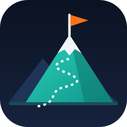

# Logo concepts

Four directions, all drawn as simple SVGs so they stay crisp from a 16px favicon up to a README banner.

## 1. Cairn (primary, in use): `logo.svg`

Stacked trail-marker stones on warm paper, with an orange capstone. Cairns are left by people who walked the route before, to guide the next climber, which is exactly Sherpa's voice: candid, experienced, quietly helpful. It's calm and distinctive, and it stands apart from the many "mountain" logos. It works well as a sticker.

| Role | Colour | Hex |
|---|---|---|
| Background | Warm paper | `#F5F1E8` |
| Ridge / secondary | Sand | `#E7E0D0` |
| Stones, darkest to lightest | Slate | `#334155` `#475569` `#64748B` `#94A3B8` |
| Capstone / accent | Summit orange | `#F97316` |
| Wordmark | Deep slate | `#0F172A` |
| Tagline | Deep teal | `#0F766E` |

## 2. Summit Path: `concepts/summit-path.svg`

A teal peak with a dotted trail winding up to an orange summit flag, on deep slate. It's the most literal of the four (the climb, the route, the goal) and the most recognisable at tiny sizes. A good choice for a dark-mode variant.

## 3. Trail S: `concepts/trail-s.svg`

A switchback trail that forms the letter **S**, on a teal disc, with a small north star. It's a monogram with a meaning, and it works as an avatar for a GitHub org or a social profile.

## 4. Prompt Peak: `concepts/prompt-peak.svg`

A terminal prompt `>` whose cursor is a mountain ridge with a flag. It says "Claude Code plugin" at a glance, but it's the least approachable for non-technical job seekers.

## Brief for a designer (or an image model)

> Minimal flat vector logo for "Sherpa", an honest job-search assistant. A cairn of five smooth stacked stones, widest at the bottom, in graduated slate greys (#334155 to #94A3B8), topped with a small orange (#F97316) capstone, on warm paper (#F5F1E8). Slightly offset stones for a hand-placed feel, no outlines, readable at 16px, no text in the mark. Mood: calm, trustworthy, candid; a seasoned guide, not a hype brand.

`icon.png` (512×512) is rendered from `logo.svg` with headless Chrome. Re-render it after changing the mark.
